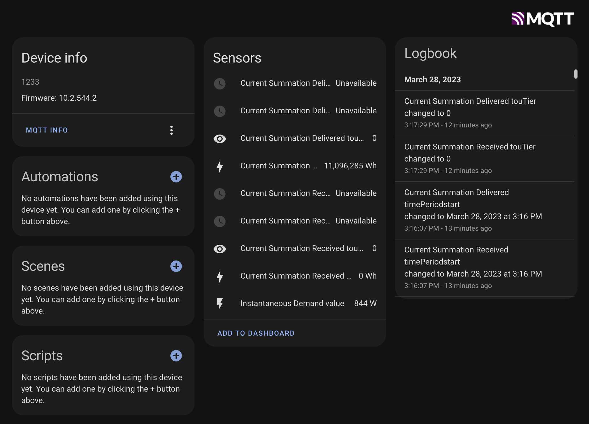

# Connect Your Smart Meter to MQTT!

Recently Xcel energy rolled out smart meter installations to facilitate TOU(Time of Use) pricing. This also benefits us, the users, as it provides us with a free way to see how much energy we're using at any time. This repo will help you get up and running with a python program that will query your meter on your network and convert its readings to MQTT messages.



## Setup

Enroll in Xcel enery launchpad, [here](https://my.xcelenergy.com/MyAccount/s/meters-and-devices/), and get your meter joined to your network.\
You'll need to register an LFDI value on the Xcel launchpad by clicking "Add a Device". Nickname, Manufacturer of Device, and Device Type can be whatever you want.

The container generates the TLS keys for you on first run — you do not need to clone this repo. Just create an empty cert directory, start the container, and read the LFDI from the logs:
```
mkdir -p ~/xcel_itron2mqtt/certs
docker run --rm \
    -v ~/xcel_itron2mqtt/certs:/opt/xcel_itron2mqtt/certs \
    ghcr.io/zaknye/xcel_itron2mqtt:latest print-lfdi
```
On first run this generates `~/xcel_itron2mqtt/certs/.cert.pem` and `.key.pem` and prints the LFDI. Re-running `print-lfdi` later will reuse the existing key and print the same LFDI again.

If you have cloned the repo and prefer to generate keys on the host (requires `openssl`):
```
./scripts/generate_keys.sh
```
Use `-p` to reprint the LFDI from existing keys, or `-n` to generate only if missing (no overwrite prompt). The keys will be saved in the local directory `certs/.cert.pem` and `certs/.key.pem`.

## Docker
Pull from remote (easy)
```
docker pull ghcr.io/zaknye/xcel_itron2mqtt:latest
```
or (harder)\
Build the container locally.
```
./scripts/docker-build.sh
```
Then run the container using the required options below.
### Options
The following are options that may be passed into the container in the form of environment variables or required volumes.
| Option | Expected Arg | Optional |
| ------ | ------------ | -------- |
| -v <path_to_cert_folder>:/opt/xcel_itron2mqtt/certs | Folder path to the certs generated with the generate keys script | NO |
| -e MQTT_SERVER | IP address of the MQTT server to communicate with | NO |
| -e MQTT_PORT | Port # of the MQTT server to communicate with, **Default: 1883**| yes |
| -e MQTT_TOPIC_PREFIX | Prefix of MQTT topic set in Home Assistant, **Default: homeassistant/** | yes |
| -e DEVICE_NAME | Name of the Home Assistant device, also used as the prefix of every entity `unique_id` and MQTT topic. Set a distinct value per meter to run **multiple meters** against one broker/HA instance. **Default: Xcel Itron 5** | yes |
| -e METER_IP | IP address of the itron meter. Useful for those that run iot devices on other vlans | yes |
| -e METER_PORT | Port number of the meter, must be set if `METER_IP` is set. **Default: 8081**| yes |
| -e MQTT_USER | Username to authenticate to the MQTT server | yes |
| -e MQTT_PASSWORD | Password to authenticate to the MQTT server | yes |
| -e CERT_PATH | Path to cert file (within the container) if different than the default | yes |
| -e KEY_PATH | Path to key file (within the container) if different than the default | yes |
| -e LOGLEVEL | Set the log level for logging output (default is INFO) | yes |

### Running multiple meters
If you have more than one Xcel meter, run one container per meter and give each a
distinct `DEVICE_NAME`. The name is baked into every entity's `unique_id` and MQTT
topic, so distinct names keep the two meters from overwriting each other's
discovery configs and readings in Home Assistant:

```
xcel_itron2mqtt_meter_a:
  image: "ghcr.io/zaknye/xcel_itron2mqtt:latest"
  environment:
    - MQTT_SERVER=127.0.0.1
    - METER_IP=<meter A IP>
    - DEVICE_NAME=Xcel Itron 5        # or leave unset to keep the default
xcel_itron2mqtt_meter_b:
  image: "ghcr.io/zaknye/xcel_itron2mqtt:latest"
  environment:
    - MQTT_SERVER=127.0.0.1
    - METER_IP=<meter B IP>
    - DEVICE_NAME=Xcel Itron 5 Garage
```

Leaving `DEVICE_NAME` unset (or set to the default `Xcel Itron 5`) reproduces the
exact `unique_id`s and topics used by previous releases, so existing single-meter
setups are unaffected.

## Compose (best way)
Docker compose is the easiest way to integrate this repo in with your other services. Below is an example of how to use compose to integrate with a mosquitto MQTT broker container.
### Example
```
mosquitto:
  image: eclipse-mosquitto
  ...
xcel_itron2mqtt:
  image: "ghcr.io/zaknye/xcel_itron2mqtt:latest"
  restart: unless-stopped
  volumes:
    - ~/xcel_itron2mqtt/certs:/opt/xcel_itron2mqtt/certs
  environment:
    - MQTT_SERVER=127.0.0.1
    - METER_IP=<Local IP>
    - METER_PORT=8081
  network_mode: host
```

See the `docker-compose.yaml` file for a working example
## CLI
### Example
```
docker run --rm -d \
    --net host \
    -e MQTT_SERVER=<IP_ADDRESS> \
    -v <path_to_cert_folder>:/opt/xcel_itron2mqtt/certs \
    ghcr.io/zaknye/xcel_itron2mqtt:latest
```
> The easiest way currently to pass through mDNS to the container is to use host networking.
>
> Maybe in the future use https://github.com/flungo-docker/avahi
### Development Example
For running as a developer, the following is helpful to allow you to work in the container
```
docker run --rm -it \
    --net host \
    -v `pwd`:/opt/xcel_itron2mqtt \
    --entrypoint /bin/sh \
    ghcr.io/zaknye/xcel_itron2mqtt:latest
```

Alternatively, the `docker-compose.yaml` will allow you to bring a up an ephemeral MQTT broker along with the xcel_itron2mqtt container. Simply copy `.env.sample` to `.env`, update variables there as needed, and run `docker compose up`. You can then use `docker exec -it xcel_itron2mqtt /bin/bash` to attach to the running container.

## Troubleshooting

### Verifying MQTT User Permissions

If messages aren't appearing in your MQTT broker, verify that your MQTT user has the correct read/write permissions.

**1. Test MQTT publish/subscribe functionality:**

These examples use the [mosquitto](https://mosquitto.org) client, but any MQTT client will likely work.

In one terminal, start a subscriber:
```bash
mosquitto_sub -h localhost -t "test/topic" -u your_mqtt_user -P your_password
```

In another terminal, publish a test message:
```bash
mosquitto_pub -h localhost -t "test/topic" -m "test message" -u your_mqtt_user -P your_password
```

If the subscriber receives the message, your MQTT user has proper permissions.

**2. Check ACL configuration:**

If messages aren't being received, check your Mosquitto ACL file (typically `/etc/mosquitto/acl.conf` or similar). Your user needs read/write access to the topics:

```
user your_mqtt_user
topic readwrite #
```

The `#` wildcard grants access to all topics. For more restrictive access, specify the topic prefix:
```
user your_mqtt_user
topic readwrite homeassistant/#
```

**3. Reload Mosquitto after configuration changes:**

After modifying ACL or password files, restart Mosquitto to apply changes:
```bash
sudo systemctl restart mosquitto
```

Or reload the configuration without full restart:
```bash
sudo systemctl reload mosquitto
```

**4. Enable debug logging:**

Set `LOGLEVEL=DEBUG` in your environment to see detailed MQTT publish attempts and responses.

## Contributing

Please feel free to create an issue with a feature request, bug, or any other comments you have on the software found here.

To contribute code, create a new fork, then create a pull request once your new feature/fix is complete.

# Contact
Zak Nye - [zaknye.com](https://zaknye.com) - zaknye@gmail.com
